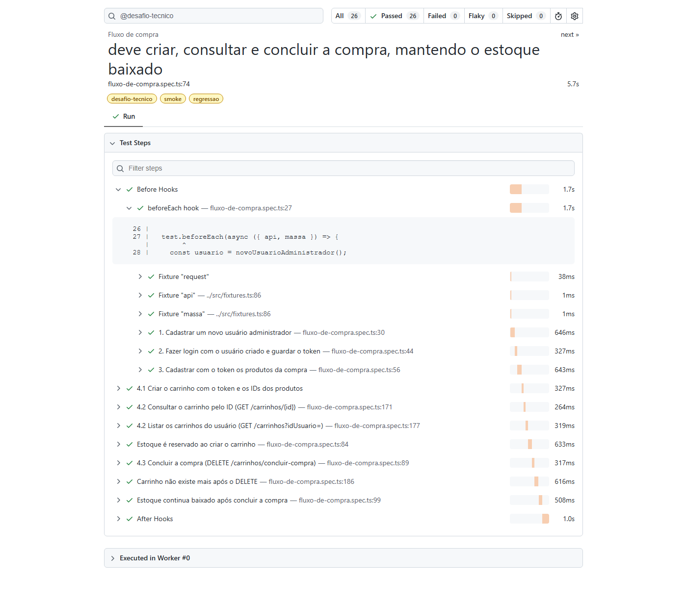
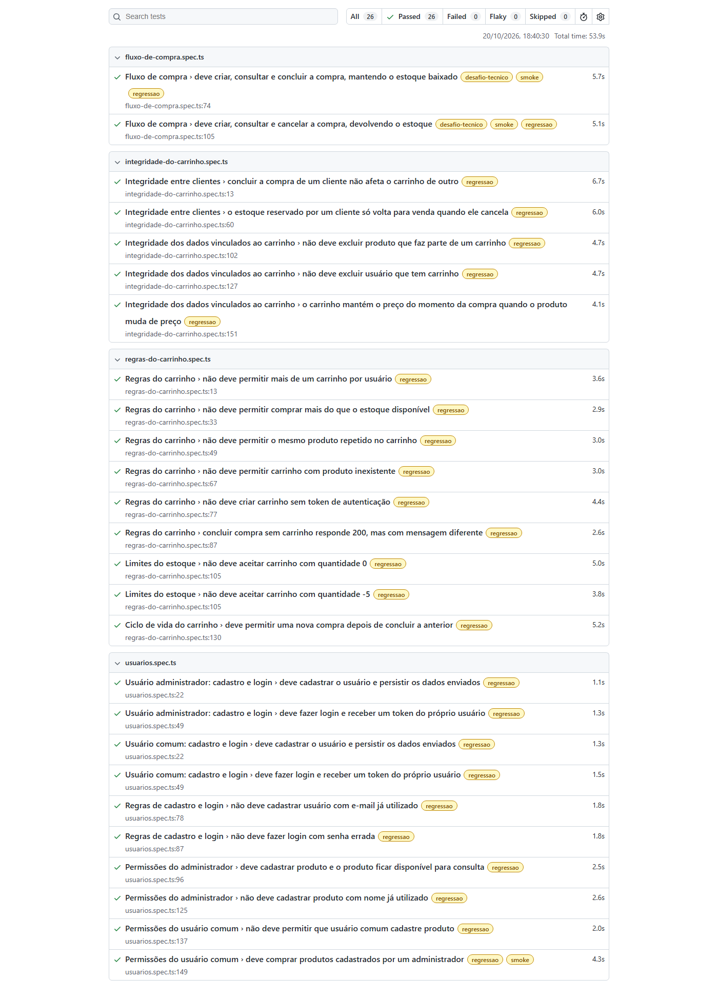

# Testes de API – Fluxo de compra ServeRest

Automação do fluxo principal de negócio da [ServeRest](https://serverest.dev) com **Playwright + TypeScript**:
cadastro de usuário → login → cadastro de produtos → carrinho (criar, consultar e encerrar).

**Navegação rápida:** [Stack](#stack) · [Preparando o ambiente](#preparando-o-ambiente) · [Como rodar](#como-rodar) · [Pipeline](#pipeline-github-actions) · [Organização](#organização) · [Cenários automatizados](#cenários-automatizados) · [Análise de qualidade](#análise-de-qualidade) · [Desafio de investigação](#desafio-de-investigação) · [Evidências](#evidências) · [Como contribuir](#como-contribuir)

## Stack

| Ferramenta                                | Versão    | Por que escolhi                                                                                                                                                                                                                                                                                          |
| ----------------------------------------- | --------- | -------------------------------------------------------------------------------------------------------------------------------------------------------------------------------------------------------------------------------------------------------------------------------------------------------- |
| [Playwright Test](https://playwright.dev) | 1.64      | Tem cliente HTTP próprio (`APIRequestContext`), fixtures para preparar e limpar a massa, `test.step` para deixar o fluxo legível no relatório, tags, paralelismo, novas tentativas e trace das requisições, tudo sem bibliotecas extras. Se o projeto crescer para testes de tela, é a mesma ferramenta. |
| TypeScript                                | 6.0       | Tipagem dos dados enviados e das respostas da API: o editor sugere os campos e um nome errado é acusado antes de rodar.                                                                                                                                                                                  |
| Node.js                                   | 22+       | Ambiente de execução.                                                                                                                                                                                                                                                                                    |
| [Faker](https://fakerjs.dev)              | 10        | Gera dados realistas em português (nomes, produtos), já que a base é zerada toda noite e tudo precisa ser criado na hora.                                                                                                                                                                                |
| ESLint + `eslint-plugin-playwright`       | 10 / 2.12 | Acusa `await` esquecido (que faz o teste passar sem validar nada) e tags inválidas.                                                                                                                                                                                                                      |
| Prettier                                  | 3         | Formatação padronizada entre as pessoas que mantêm o projeto.                                                                                                                                                                                                                                            |

## Preparando o ambiente

Funciona em Windows, Linux e macOS. Siga os passos na ordem.

### 1. Instale o que é necessário

| Ferramenta                               | Versão                                                       | Para quê                                 |
| ---------------------------------------- | ------------------------------------------------------------ | ---------------------------------------- |
| [Node.js](https://nodejs.org)            | **22 ou superior** (a versão de referência está no `.nvmrc`) | Executar os testes                       |
| [Git](https://git-scm.com)               | qualquer versão recente                                      | Baixar o projeto e versionar as mudanças |
| [VS Code](https://code.visualstudio.com) | opcional, mas recomendado                                    | Editar e rodar os testes pela interface  |

Para conferir se já estão instalados:

```bash
node -v   # deve mostrar v22.x.x ou maior
npm -v
git --version
```

> Usa vários projetos com versões diferentes do Node? Instale o [nvm](https://github.com/nvm-sh/nvm) (Linux/macOS) ou o [nvm-windows](https://github.com/coreybutler/nvm-windows) e rode `nvm use` na pasta do projeto para trocar para a versão certa.

### 2. Baixe o projeto e instale as dependências

```bash
git clone <url-do-repositorio>
cd serverest-api
npm ci
```

Use `npm ci` e não `npm install`. O `npm ci` instala exatamente as versões registradas no `package-lock.json`, então todo mundo roda com as mesmas versões e o resultado não muda de uma máquina para outra. Só use `npm install <pacote>` quando quiser **adicionar ou atualizar** uma dependência (e faça commit do `package-lock.json` alterado).

Como os testes são só de API, **não é preciso** rodar `npx playwright install` (esse comando baixa navegadores, que este projeto não usa).

### 3. Confirme que está tudo funcionando

```bash
npm run verificar   # tipos, lint e formatação: não deve mostrar nenhum erro
npm test            # todos os testes devem passar
```

### 4. (Recomendado) Configure o VS Code

Ao abrir a pasta, o VS Code vai sugerir instalar três extensões (recomendadas em `.vscode/extensions.json`):

| Extensão                       | Para quê                                                            |
| ------------------------------ | ------------------------------------------------------------------- |
| **Playwright Test for VSCode** | Rodar ou depurar um teste específico clicando no ícone ao lado dele |
| **ESLint**                     | Mostrar os problemas do lint enquanto você escreve                  |
| **Prettier**                   | Formatar o arquivo automaticamente ao salvar                        |

As configurações compartilhadas do editor (`.vscode/settings.json`) já ativam a formatação e as correções automáticas do lint ao salvar.

## Como rodar

**Por categoria (tags)**

Cada teste tem uma ou mais categorias:

| Tag                | O que é                                                                      | Testes                                                                                              |
| ------------------ | ---------------------------------------------------------------------------- | --------------------------------------------------------------------------------------------------- |
| `@regressao`       | A suíte completa. **Todo teste tem esta tag.**                               | Todos (26)                                                                                          |
| `@smoke`           | Responde rápido à pergunta "o essencial do negócio está funcionando?"        | Fluxo de compra (concluir e cancelar) e cliente comum comprando produtos cadastrados pelo admin (3) |
| `@desafio-tecnico` | O fluxo obrigatório pedido no desafio: usuário → login → produtos → carrinho | Fluxo de compra: concluir e cancelar (2)                                                            |

```bash
npm run test:regressao    # todos os testes com @regressao
npm run test:smoke        # só @smoke (cerca de 15 segundos)
npm run test:desafio      # só @desafio-tecnico
```

Para combinar tags, use expressões do Playwright. Por exemplo, testes de regressão que não são smoke: `npx playwright test --grep @regressao --grep-invert @smoke`.

**Outras formas**

```bash
npm test                                         # tudo
npx playwright test tests/usuarios.spec.ts       # um arquivo só
npx playwright test -g "cancelar a compra"       # um teste só, pelo nome
npm run report                                   # abre o relatório HTML da última execução
```

**Qualidade do código**

```bash
npm run verificar         # roda os três abaixo de uma vez (use antes de abrir um Pull Request)
npm run typecheck         # checagem de tipos do TypeScript
npm run lint              # ESLint: boas práticas de TypeScript e de Playwright
npm run format:check      # confere se o código segue a formatação padrão (Prettier)

npm run lint:fix          # corrige automaticamente o que o lint souber corrigir
npm run format            # formata todos os arquivos
```

### Investigando uma falha

Quando um teste falha, o Playwright guarda um **trace**: o registro de cada requisição e resposta do teste, com URL, headers e corpo. Para ver:

1. Rode `npm run report`.
2. Abra o teste que falhou.
3. Clique em **Traces**.

Assim dá para ver exatamente o que a API respondeu, sem precisar rodar o teste de novo e torcer para a falha se repetir.

### Rodando contra outro ambiente

Por padrão os testes apontam para `https://serverest.dev`. Para usar outro endereço (por exemplo, a ServeRest rodando na sua máquina com `npx serverest@latest`, que sobe em `http://localhost:3000`), defina a variável `BASE_URL`:

```bash
# Linux / macOS / Git Bash
BASE_URL=http://localhost:3000 npm test
```

```powershell
# Windows PowerShell
$env:BASE_URL="http://localhost:3000"; npm test
```

A ServeRest local é útil quando o ambiente público estiver fora do ar, lento ou recusando requisições.

### Problemas comuns

| Sintoma                                 | Causa provável                                     | O que fazer                                                                                                           |
| --------------------------------------- | -------------------------------------------------- | --------------------------------------------------------------------------------------------------------------------- |
| `ECONNRESET` ou timeout                 | Instabilidade do ambiente público                  | O teste já é repetido 1 vez automaticamente. Se persistir, tente mais tarde ou use a ServeRest local.                 |
| Status `429` (Too Many Requests)        | Muitas requisições simultâneas ao ambiente público | Não aumente o número de `workers` no `playwright.config.ts`. Para rodar muitas vezes seguidas, use a ServeRest local. |
| Teste marcado como `flaky` no relatório | Falhou na 1ª tentativa e passou na 2ª              | Geralmente é instabilidade de rede. Se for sempre o mesmo teste, investigue.                                          |
| Falhas perto da meia-noite              | A base da ServeRest é apagada toda noite           | Rode novamente depois do reset.                                                                                       |
| Erro de sintaxe ao instalar ou rodar    | Versão do Node abaixo da 22                        | Atualize o Node (veja o passo 1).                                                                                     |

## Pipeline (GitHub Actions)

A pipeline fica em [`.github/workflows/testes-api.yml`](.github/workflows/testes-api.yml) e roda em dois jobs, um depois do outro:

```
Saúde da API  ──►  Testes
```

| Job              | O que faz                                                                                                                                                                                                                                                                                                                                                              |
| ---------------- | ---------------------------------------------------------------------------------------------------------------------------------------------------------------------------------------------------------------------------------------------------------------------------------------------------------------------------------------------------------------------- |
| **Saúde da API** | Confirma que a ServeRest responde (status 200) nos três recursos usados pelo fluxo: `/usuarios`, `/produtos` e `/carrinhos`. Tenta até 5 vezes antes de desistir. Se a API estiver fora do ar, a pipeline para aqui com o alerta **"API indisponível"**, e os testes nem rodam. Assim, uma queda do ambiente não aparece como 26 testes falhando, o que pareceria bug. |
| **Testes**       | Instala as dependências com `npm ci`, roda `npm run verificar` (tipos, lint e formatação) e executa a suíte com **2 workers**. O relatório HTML é publicado como artefato (`relatorio-playwright`) mesmo quando há falha, e as falhas aparecem marcadas direto no Pull Request.                                                                                        |

**Quando roda:**

| Gatilho                                                             | Testes executados                                                                                                                         |
| ------------------------------------------------------------------- | ----------------------------------------------------------------------------------------------------------------------------------------- |
| Todo Pull Request e todo push na branch `main`                      | `@regressao`                                                                                                                              |
| Agendada, de segunda a sexta às 9h (Brasília)                       | `@regressao`. Como a base é apagada toda noite, confirma que o fluxo funciona com o ambiente zerado, mesmo em dias sem mudança no código. |
| Manual, pela aba **Actions** → **Testes de API** → **Run workflow** | Você escolhe: `@regressao`, `@smoke` ou `@desafio-tecnico`                                                                                |

**Por que 2 workers:** é o equilíbrio entre velocidade (cerca de 1 minuto para a suíte completa) e respeito ao ambiente público, que responde `429 Too Many Requests` quando recebe muitas requisições ao mesmo tempo.

**Onde ver o relatório:** na execução, em **Summary** → **Artifacts** → `relatorio-playwright`. Baixe, descompacte e abra o `index.html`.

**Outro ambiente:** para rodar a pipeline contra outro endereço, crie a variável `BASE_URL` em **Settings** → **Secrets and variables** → **Actions** → **Variables**. Sem ela, a pipeline usa `https://serverest.dev`.

## Organização

```
src/
  api/serverest.ts      → uma classe por recurso (usuarios, login, produtos, carrinhos); só faz as requisições
  dados/fabrica.ts      → gera usuários e produtos novos, com dados únicos
  dados/mensagens.ts    → mensagens esperadas da API, em um só lugar
  fixtures.ts           → injeta a API nos testes, prepara massa e limpa tudo no final
  verificacoes.ts       → verificações reaproveitadas (conferir estoque, ler o conteúdo do token)
  tipos.ts              → formatos dos dados enviados e das respostas da API
tests/
  fluxo-de-compra.spec.ts         → o fluxo obrigatório do desafio, passo a passo (tags @desafio-tecnico e @smoke)
  regras-do-carrinho.spec.ts      → regras do carrinho, limites do estoque e ciclo de vida (comprar de novo)
  integridade-do-carrinho.spec.ts → isolamento entre clientes e proteção dos dados ligados ao carrinho
  usuarios.spec.ts                → os dois perfis (administrador e comum): cadastro, login e permissões

.github/workflows/testes-api.yml  → pipeline: saúde da API e testes (GitHub Actions)
.vscode/                          → extensões e configurações do editor compartilhadas pelo time
eslint.config.js                  → regras do lint
.prettierrc.json                  → regras de formatação
playwright.config.ts              → URL da API, paralelismo, novas tentativas, trace e relatório
```

A ServeRest tem **dois perfis de usuário**. O **administrador** é o único que cadastra produtos. O **comum** (cliente) só compra. O fluxo de compra usa um administrador, porque o desafio pede que o mesmo usuário cadastre os produtos. A suíte `usuarios`:

- roda os mesmos testes de cadastro e login para os dois perfis;
- valida as permissões de cada um;
- cobre a integração entre eles: o admin cadastra os produtos e o cliente compra com o próprio token.

Decisões que vale explicar:

- **As asserções ficam nos testes, não nas classes de API.** As classes só devolvem a resposta. Assim, cada teste mostra claramente o que espera.
- **A passagem de dados entre as chamadas fica à vista.** No `fluxo-de-compra.spec.ts`, o `_id` do usuário, o `token` do login e os `_id` dos produtos são guardados em variáveis e passados como parâmetro para as chamadas seguintes. O relatório do Playwright mostra cada passo numerado (`test.step`).
- **O corpo da resposta é comparado por inteiro** (`toEqual`) nos pontos críticos. No carrinho, o objeto esperado é calculado a partir do que foi cadastrado: preço unitário, quantidade total e preço total. Com isso, um campo errado, faltando ou sobrando faz o teste falhar.
- **Cada teste cria a própria massa.** Por isso eles rodam em paralelo sem interferir uns nos outros.
- **As respostas da API são tipadas.** Cada método das classes de API informa o formato do corpo de sucesso (`src/tipos.ts`). Com isso, o editor sugere os campos (`_id`, `authorization`...) e um nome de campo errado é acusado antes de rodar o teste.
- **O lint protege contra falso positivo.** O erro mais perigoso em testes assíncronos é esquecer um `await`: o teste termina antes de a verificação acontecer e passa sem validar nada. As regras `no-floating-promises` (TypeScript) e `missing-playwright-await` (Playwright) acusam esse erro no editor, no `npm run verificar` e na pipeline, antes de o código chegar à branch principal.
- **O TypeScript está fixado na versão 6.0.** O `typescript-eslint` ainda não suporta o TypeScript 7. Quando suportar, basta atualizar os dois juntos.

## Cenários automatizados

São 26 testes. Todos têm a tag `@regressao`. As outras tags aparecem na coluna ao lado.

**Fluxo de compra**, o fluxo obrigatório do desafio (`fluxo-de-compra.spec.ts`)

| Cenário                                                                                                                  | Tags extras                 |
| ------------------------------------------------------------------------------------------------------------------------ | --------------------------- |
| Cadastrar usuário, fazer login, cadastrar produtos, criar, consultar e **concluir** a compra, mantendo o estoque baixado | `@desafio-tecnico` `@smoke` |
| Cadastrar usuário, fazer login, cadastrar produtos, criar, consultar e **cancelar** a compra, devolvendo o estoque       | `@desafio-tecnico` `@smoke` |

**Regras do carrinho** (`regras-do-carrinho.spec.ts`)

| Cenário                                                               |
| --------------------------------------------------------------------- |
| Não permite mais de um carrinho por usuário                           |
| Não permite comprar mais do que o estoque disponível                  |
| Não permite o mesmo produto repetido no carrinho                      |
| Não permite carrinho com produto inexistente                          |
| Não cria carrinho sem token de autenticação                           |
| Concluir compra sem carrinho responde 200, mas com mensagem diferente |
| Não aceita carrinho com quantidade 0                                  |
| Não aceita carrinho com quantidade -5                                 |
| Permite uma nova compra depois de concluir a anterior                 |

**Integridade do carrinho** (`integridade-do-carrinho.spec.ts`)

| Cenário                                                                                                              |
| -------------------------------------------------------------------------------------------------------------------- |
| Concluir a compra de um cliente não afeta o carrinho de outro                                                        |
| O estoque reservado por um cliente só volta para venda quando ele cancela (inclui comprar exatamente todo o estoque) |
| Não exclui produto que faz parte de um carrinho                                                                      |
| Não exclui usuário que tem carrinho                                                                                  |
| O carrinho mantém o preço do momento da compra quando o produto muda de preço                                        |

**Usuários: administrador e comum** (`usuarios.spec.ts`)

| Cenário                                                                   | Tags extras |
| ------------------------------------------------------------------------- | ----------- |
| Cadastra o usuário administrador e persiste os dados enviados             |             |
| Administrador faz login e recebe um token do próprio usuário              |             |
| Cadastra o usuário comum e persiste os dados enviados                     |             |
| Usuário comum faz login e recebe um token do próprio usuário              |             |
| Não cadastra usuário com e-mail já utilizado                              |             |
| Não faz login com senha errada                                            |             |
| Administrador cadastra produto, e o produto fica disponível para consulta |             |
| Não cadastra produto com nome já utilizado                                |             |
| Usuário comum não pode cadastrar produto (403)                            |             |
| Usuário comum compra produtos cadastrados por um administrador            | `@smoke`    |

## Análise de qualidade

### Contexto que influenciou as decisões

A base da ServeRest **é apagada toda noite**. Daí vêm três consequências:

1. Nenhum teste pode depender de dados existentes (IDs fixos, usuário "de teste" cadastrado antes). Tudo é criado na hora, a cada execução.
2. Os dados são únicos (e-mail e nome de produto com sufixo aleatório), porque durante o dia outras pessoas usam o mesmo ambiente, e a API não aceita e-mail nem nome de produto repetidos.
3. Ao final de cada teste, o que foi criado é apagado (carrinho → produtos → usuário, nessa ordem, porque a API bloqueia a exclusão de produto em carrinho e de usuário com carrinho). A limpeza é uma cortesia com o ambiente compartilhado, não uma dependência: se algo sobrar, o reset noturno resolve. Por isso a limpeza não faz o teste falhar.

### Cenários mais críticos e por quê

| Cenário                                                                                     | Por que é crítico                                                                                                                                                             |
| ------------------------------------------------------------------------------------------- | ----------------------------------------------------------------------------------------------------------------------------------------------------------------------------- |
| Fluxo completo até **concluir** a compra                                                    | É o caminho que gera receita. Se ele quebra, o negócio para.                                                                                                                  |
| **Estoque** baixa ao criar o carrinho, continua baixado ao concluir e **volta** ao cancelar | Erro de estoque significa vender o que não existe ou travar produto que estaria disponível. É o efeito colateral mais caro do fluxo, e o status code sozinho não mostra isso. |
| Consulta do carrinho com **valores corretos** (preço unitário, totais, usuário dono)        | Total errado é cobrança errada.                                                                                                                                               |
| Só **1 carrinho por usuário** e nada de quantidade **acima do estoque**                     | São as travas que impedem vender além do disponível. Também confirmo que a tentativa rejeitada não mexeu no estoque.                                                          |
| Carrinho **sem token** é recusado                                                           | Sem isso, qualquer pessoa compraria em nome de qualquer usuário.                                                                                                              |
| **Usuário comum** cadastra, faz login e compra, mas **não** cadastra produto (403)          | O cliente é quem gera a venda, e a separação de perfis impede que qualquer cliente altere o catálogo.                                                                         |
| Carrinho com quantidade **zero ou negativa** é recusado                                     | Se fosse aceito, criar o carrinho faria o estoque _aumentar_ sem nenhuma compra real.                                                                                         |
| Comprar **exatamente todo o estoque** é aceito                                              | É o valor limite: `estoque + 1` é recusado, `estoque` tem que passar. Erros de `>` no lugar de `>=` aparecem aqui. Coberto no primeiro passo do teste de disputa de estoque.  |
| A ação de um cliente **não afeta o carrinho de outro**                                      | O DELETE do carrinho não recebe ID, só o token. Se essa ligação falhar, um cliente apaga o carrinho de outro.                                                                 |
| O estoque reservado **só volta para venda quando o cliente cancela**                        | Versão sequencial (e por isso confiável) da disputa pela última unidade entre dois clientes.                                                                                  |
| Produto ou usuário com carrinho **não pode ser excluído**                                   | Se pudesse, ficaria um carrinho apontando para um produto que não existe ou sem dono: um pedido quebrado.                                                                     |
| O carrinho **mantém o preço** do momento da compra                                          | Se o preço mudar depois, o cliente não pode pagar um valor diferente do que viu.                                                                                              |
| **Comprar de novo** depois de concluir                                                      | A trava de "1 carrinho por usuário" precisa ser liberada; senão o cliente compra uma única vez.                                                                               |

### Riscos identificados no mapeamento

- **O DELETE devolve 200 nos dois casos.** `concluir-compra` e `cancelar-compra` respondem 200 tanto quando excluem quanto quando _não existe carrinho_. Um teste que olhe só o status passa mesmo sem excluir nada (falso positivo). Por isso valido a mensagem e, depois, confirmo que o carrinho sumiu (`GET /carrinhos/{id}` → 400). Há um teste dedicado a esse comportamento.
- **O Swagger diverge da API real.** A documentação diz que o cancelamento retorna `"Registro excluído com sucesso"`, mas a API devolve `"Registro excluído com sucesso. Estoque dos produtos reabastecido"`. Também nas exclusões bloqueadas: a API devolve, além da mensagem, o ID do carrinho que impede a exclusão (`idCarrinhos` ou `idCarrinho`), o que não está no exemplo do Swagger. Achei as duas divergências durante a automação. Conclusão: antes de escrever um cenário novo, confirmo o comportamento real da API, e as asserções seguem o que foi observado. A documentação não é tratada como fonte da verdade.
- **O reset noturno pode atingir uma execução em andamento.** Um teste rodando perto da virada do dia pode ter os dados apagados no meio e falhar sem bug real. Os testes são curtos (segundos) e criam tudo na hora, o que reduz bastante a janela, mas o risco existe e convém lembrar dele ao analisar uma falha nesse horário.
- **O ambiente é público e compartilhado.** Durante a automação ele derrubou conexões (`ECONNRESET`) e respondeu `429 Too Many Requests` quando recebeu muitas requisições simultâneas. Para lidar com isso:
  - o paralelismo está limitado a 2 workers;
  - cada teste tem 1 nova tentativa. O Playwright marca como `flaky` o teste que só passou na segunda vez, então a instabilidade continua visível no relatório e não fica escondida.
- **Dados expostos sem autenticação.** O `GET /carrinhos` é público e lista os carrinhos de _todos_ os usuários, e o `GET /usuarios` devolve inclusive a senha de cada usuário. Como a ServeRest é uma ferramenta de estudo, isso deve ser intencional, mas num sistema real seria um problema grave de privacidade e segurança, e eu reportaria.
- **O token carrega a senha em texto aberto.** O JWT do login traz no conteúdo o e-mail **e a senha** do usuário, legíveis por qualquer pessoa que tenha o token. Num sistema real, isso seria um achado de segurança grave.
- **O token vale 600 segundos.** Os testes não são afetados porque cada um faz login novo e termina em segundos.

### O que decidi testar

O critério foi priorizar o que, se quebrar, causa prejuízo ao negócio ou ao cliente, na ordem da tabela de cenários críticos. Na prática:

- **O fluxo obrigatório completo, nas duas formas de encerrar** (concluir e cancelar). As duas fazem parte do desafio ("conclusão ou cancelamento") e cada uma tem um efeito diferente no estoque.
- **O estado do sistema depois de cada ação, e não só a resposta.** Confiro o estoque antes e depois, consulto o carrinho por ID e pela lista do usuário e confirmo que o carrinho deixou de existir depois do DELETE.
- **As regras e os limites que protegem o estoque e o dinheiro:** um carrinho por usuário, estoque insuficiente, quantidade zero ou negativa, produto e usuário que não podem ser excluídos, preço congelado no carrinho.
- **A interação entre dois clientes e entre os dois perfis**, porque é onde aparecem os erros de "dado de uma pessoa afetando outra".

A lista completa dos 26 testes está em [Cenários automatizados](#cenários-automatizados).

### O que decidi não testar (e por quê)

| Fora do escopo                                                                                     | Justificativa                                                                                                                                                                                                                        |
| -------------------------------------------------------------------------------------------------- | ------------------------------------------------------------------------------------------------------------------------------------------------------------------------------------------------------------------------------------ |
| CRUD completo de usuários e produtos (editar usuário, listagens com filtros, exclusão com sucesso) | O objetivo é a integração do fluxo de compra. De usuários e produtos, testei o que o fluxo usa ou o que afeta o carrinho: cadastro, login, permissões, alteração de preço e exclusões bloqueadas. O restante seriam suítes próprias. |
| Expiração real do token                                                                            | Exigiria esperar 10 minutos a cada execução. O custo é alto para pouco ganho, e o caso "sem token" já cobre a rejeição.                                                                                                              |
| Concorrência real (dois clientes disputando a última unidade _no mesmo instante_)                  | A versão sequencial está coberta. A simultânea não é determinística em ambiente público e compartilhado. Eu levaria esse teste para um ambiente controlado (ServeRest local).                                                        |
| Carga e performance                                                                                | Gerar carga num serviço público e gratuito prejudica outras pessoas e não daria medições confiáveis.                                                                                                                                 |
| Validação formal de schema (JSON Schema)                                                           | As comparações de corpo inteiro com `toEqual` já pegam campo faltando, sobrando ou com valor errado nos pontos críticos. Uma biblioteca de schema traria mais complexidade do que valor para este escopo.                            |
| Segurança aprofundada (injeção, força bruta, varredura de vulnerabilidades)                        | Foge do escopo funcional do desafio. Os achados de exposição de dados estão registrados nos riscos, e os casos de token adulterado estão em "Próximos passos".                                                                       |

### Próximos passos

Mapeados, mas ainda não automatizados, em ordem de prioridade:

1. **Segurança da sessão:** token adulterado ou malformado, e token de um usuário que já foi excluído (os dois devem ser recusados com 401).
2. **Validação de entrada:** e-mail em formato inválido, campos obrigatórios faltando, preço ou quantidade negativos no cadastro de produto e carrinho com lista vazia. São bons candidatos a testes parametrizados.

## Desafio de investigação

> **Cenário:** "Às vezes, o cliente paga, mas o pedido não aparece na tela de 'Meus Pedidos'." Sem acesso ao código-fonte; com acesso ao ambiente de produção, logs básicos e apoio dos times de Produto e Backend.

### Minha primeira ação

**Pegar casos reais e seguir um deles do começo ao fim.** Peço ao time de Produto ou de Suporte de 2 a 3 reclamações concretas, com o identificador do cliente, o horário do pagamento, o valor e o meio de pagamento. Com um caso em mãos, sigo o rastro nos logs: o pagamento foi confirmado → o pedido foi criado → o pedido está ligado a esse cliente → a tela "Meus Pedidos" consulta e mostra esse pedido.

**Por quê:** "às vezes" é a palavra mais importante do relato. Um problema intermitente não se resolve tentando reproduzir às cegas, porque posso fazer dez compras e todas funcionarem. Um caso real que **já falhou** transforma uma reclamação vaga em um rastro que dá para seguir. E me mostra **em que elo da cadeia** o pedido se perde, que é o que define quem investiga o quê.

### Hipótese inicial

**O pedido depende de uma confirmação de pagamento que chega depois, e às vezes essa confirmação falha, atrasa ou chega fora de ordem.**

Na maioria das lojas, o pagamento é confirmado pela operadora por uma notificação assíncrona (um "aviso" que chega ao sistema depois). Se esse aviso dá erro, demora, é perdido ou chega duplicado, o dinheiro sai da conta do cliente, mas o pedido fica preso em um estado intermediário (por exemplo, "aguardando pagamento") ou nem é criado. Se a tela "Meus Pedidos" mostra só pedidos confirmados, ele "some" para o cliente.

Escolhi essa hipótese porque ela explica bem o "às vezes". Um erro de lógica comum falharia sempre; falhas intermitentes costumam vir de processos assíncronos, tempo limite de resposta e novas tentativas.

Não descarto outras hipóteses, em ordem do que eu verificaria:

1. **O pedido existe, mas a tela não mostra:** cache, banco de leitura com atraso, filtro por status ou paginação.
2. **O pedido foi criado para outra conta:** compra sem login, conta duplicada, sessão trocada. É o mesmo tipo de risco que cobri nos testes de isolamento entre clientes.
3. **O pedido só seria criado quando o cliente volta da página de pagamento**, e ele fechou o navegador ou o app antes disso.

### Como reduziria a incerteza rapidamente

A ideia é dividir o caminho ao meio a cada pergunta, como uma busca binária. Cada resposta descarta metade das hipóteses:

1. **O pedido existe?** Com o time de Backend, consulto o pedido do caso real direto na API ou no banco, sem passar pela tela.
   - **Existe:** o problema está na **exibição**. Confiro o status do pedido, a qual cliente ele pertence e se a API de "Meus Pedidos" o retorna. Se a API retorna e a tela não mostra, é front-end ou cache. Hipóteses 1 e 2.
   - **Não existe:** o problema está na **criação**. Busco nos logs, no horário do pagamento, se a confirmação da operadora chegou, se deu erro, demorou ou foi repetida. Hipótese inicial e hipótese 3.
2. **Qual é o padrão?** Comparo os casos afetados: meio de pagamento (PIX e boleto são mais assíncronos que cartão), horário (picos de acesso), app ou navegador e versão, tempo entre o pagamento e a confirmação. Um ponto em comum entre os casos costuma apontar a causa.
3. **Qual é o tamanho?** Peço ao Backend que cruze, em um período, os **pagamentos aprovados na operadora** com os **pedidos criados**. A diferença entre as duas listas mostra a taxa de ocorrência e **todos** os clientes afetados, não só os que reclamaram. Isso define a prioridade: cliente que pagou e não recebeu é impacto financeiro, jurídico e de reputação.

Em paralelo, combino com Produto e Suporte o tratamento dos clientes já afetados (conciliar os pedidos manualmente ou estornar), porque a investigação não pode deixar quem já pagou esperando.

Depois de achar a causa, eu garantiria que o problema não volta:

- **Teste automatizado do cenário:** por exemplo, confirmação de pagamento atrasada ou duplicada.
- **Alerta em produção:** quando houver pagamento aprovado sem pedido correspondente depois de X minutos.

É o mesmo princípio que segui nesta automação. Uma resposta de sucesso não basta: confiro o **estado** do sistema depois da ação. Foi assim que tratei o `DELETE` do carrinho, que responde 200 até quando não exclui nada.

## Evidências

A pasta [`evidencias/`](evidencias/) tem o resultado de uma execução completa da suíte contra `https://serverest.dev`: **26 testes, 26 passando, 0 flaky**.

| Arquivo                                                                         | O que é                                                                                                    |
| ------------------------------------------------------------------------------- | ---------------------------------------------------------------------------------------------------------- |
| [`relatorio-html/index.html`](evidencias/relatorio-html/index.html)             | Relatório interativo do Playwright. Abra no navegador para ver cada teste, os passos, as tags e a duração. |
| [`execucao.log`](evidencias/execucao.log)                                       | Saída do terminal da execução.                                                                             |
| [`01-visao-geral.png`](evidencias/01-visao-geral.png)                           | Todos os testes, com resultado, tags e duração.                                                            |
| [`02-tag-desafio-tecnico.png`](evidencias/02-tag-desafio-tecnico.png)           | Relatório filtrado pela tag `@desafio-tecnico`.                                                            |
| [`03-passos-do-fluxo-concluir.png`](evidencias/03-passos-do-fluxo-concluir.png) | O fluxo do desafio aberto passo a passo: usuário → login → produtos → carrinho.                            |
| [`04-tag-smoke.png`](evidencias/04-tag-smoke.png)                               | Relatório filtrado pela tag `@smoke`.                                                                      |

**O fluxo do desafio, passo a passo:**



**A suíte completa:**



Para gerar um novo relatório de evidências na mesma pasta:

```bash
# Linux / macOS / Git Bash
PLAYWRIGHT_HTML_OUTPUT_DIR=evidencias/relatorio-html npx playwright test
```

```powershell
# Windows PowerShell
$env:PLAYWRIGHT_HTML_OUTPUT_DIR="evidencias/relatorio-html"; npx playwright test
```

## Como contribuir

Este projeto é mantido por mais de uma pessoa. Para ele continuar fácil de entender:

1. **Crie uma branch** a partir da principal para cada mudança (`git checkout -b teste/nome-do-cenario`).
2. **Siga os padrões do projeto:**
   - Nomes de testes, variáveis e funções em **português**, descrevendo o comportamento (`deve...` / `não deve...`).
   - As classes em `src/api` **só fazem requisições**. As asserções ficam nos testes.
   - Nunca use IDs ou usuários fixos: a base é apagada toda noite. Gere dados com `src/dados/fabrica.ts`.
   - Tudo o que o teste criar deve ser registrado na fixture `massa` (`guardarUsuario`, `guardarToken`, `guardarProduto`) para ser apagado no final.
   - Uma mensagem nova da API vai em `src/dados/mensagens.ts`, não escrita direto no teste.
   - Precisa de um usuário pronto como pré-condição? Use as fixtures `adminLogado`, `adminComProdutos` ou `clienteLogado`.
   - Valide o **corpo** da resposta, não só o status code. A ServeRest devolve o mesmo status para situações diferentes.
   - **Todo teste novo precisa da tag `@regressao`**, normalmente herdada do `test.describe`. Adicione `@smoke` só se o teste for essencial e rápido, e `@desafio-tecnico` só se fizer parte do fluxo pedido no desafio.
     - As tags aceitas ficam no `eslint.config.js` (regra `playwright/valid-test-tags`). Uma tag digitada errada vira erro de lint em vez de esconder o teste em silêncio. Para criar uma categoria nova, inclua a tag nessa lista e na tabela de tags acima.
     - Para conferir se algum teste ficou sem `@regressao`, rode `npx playwright test --list --grep-invert @regressao`. O esperado é "No tests found".
3. **Antes de abrir o Pull Request**, rode `npm run verificar` e `npm test` e confirme que tudo passa. Ao abrir o Pull Request, a pipeline roda as mesmas verificações e a suíte completa; só faça o merge com ela verde.
4. **Atualize este README** se a mudança alterar a configuração, a organização ou a análise de qualidade (riscos, o que é e o que não é testado).
